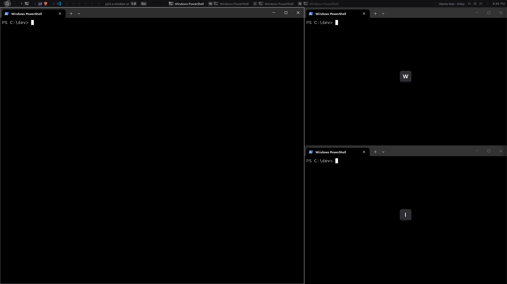

# MoraWM

A fast, keyboard-driven tiling window manager for Windows 11.



MoraWM arranges your windows automatically so they never overlap, gives you
nine workspaces to organise them, and adds a slim status bar to every monitor.
Everything is driven by **Alt** shortcuts, and the mouse keeps working as usual.

## Features

- **Automatic tiling.** One main window on the left, two stacked on the right.
  Prefer columns or rows? Press **Alt+T**. Extra windows wait out of view
  instead of getting squeezed, and step in when a tile frees up.
- **Nine workspaces.** Each remembers its windows and layout. Switching
  is instant.
- **Multi-monitor support.** Every monitor shows its own workspace and its own
  bar. Move focus between monitors, swap their workspaces, or drag a window
  onto another screen to tile it there. Plugging in, unplugging, docking or
  changing resolution is handled live; workspaces from a removed monitor come
  back when it does.
- **Pick and swap.** **Alt+M** labels every window with a letter. Press one and
  the two windows trade places, even across monitors.
- **Respects you.** Drag, resize or maximize a window and MoraWM leaves it
  there. Fullscreen apps and games are left alone. **Alt+R** tiles everything
  again.
- **Status bar.** Workspaces with their app icons, a chip per window (click to
  focus), playing media and the clock.
- **Safe to quit.** On exit, crash, sign-out or `taskkill`, every window is put
  back where you can see it and Windows animations are restored.

## Keyboard shortcuts

| Shortcut | Action |
| --- | --- |
| **Alt+1** … **Alt+9** | Switch to workspace 1–9 |
| **Alt+Shift+1** … **Alt+Shift+9** | Send the focused window to that workspace |
| **Alt+H** / **Alt+L** | Focus previous / next window |
| **Alt+M**, then a letter | Swap the focused window with the one showing that letter |
| **Alt+M**, then a digit | Send the focused window to that workspace |
| **Alt+`** | Focus the next monitor |
| **Alt+S** | Swap workspaces between this monitor and the next |
| **Alt+T** | Cycle layout: main / columns / rows |
| **Alt+R** | Re-tile every window on the workspace |
| **Alt+Shift+Space** | Float the focused window (press again to tile it) |
| **Alt+Shift+T** | Turn tiling off / on for this workspace |
| **Alt+Q** | Close the focused window |
| **Alt+Shift+Q** | Quit MoraWM |

## Getting started

Download [`morawm.exe`](https://github.com/LukashevychAndrii/morawm/releases/latest/download/morawm.exe)
from the [latest release](https://github.com/LukashevychAndrii/morawm/releases/latest)
and run it; your open windows are tiled right away. It is a single portable
file with nothing to install. Press **Alt+Shift+Q** to quit and get your
desktop back.

The release also has `morawm-<version>.zip` (the executable plus `morawm.pdb`)
and `morawm-<version>-symbols.zip` (`morawm.pdb` alone). Keep `morawm.pdb`
beside the executable if you want crash reports to name functions.
`SHA256SUMS.txt` lists checksums for every file.

MoraWM is not code-signed, so Windows SmartScreen may warn the first time you
run it. Choose **More info**, then **Run anyway**.

To start it with Windows, press **Win+R**, run `shell:startup`, and put a
shortcut to `morawm.exe` in that folder.

## Configuration (optional)

Create `%LOCALAPPDATA%\MoraWM\morawm.conf` to pin workspaces to monitors and
launch programs at startup:

```
# Monitor 1 (leftmost) starts on workspace 2
workspace 2 monitor 1

# Open Firefox on workspace 2
exec firefox.exe workspace 2

# Open VLC on whatever monitor 2 shows
exec "C:\Program Files\VideoLAN\VLC\vlc.exe" monitor 2
```

Lines starting with `#` are comments. Mistakes never stop MoraWM from
starting; they are written to the log and skipped.

## Building

Requirements: Visual Studio (or Build Tools) with the *Desktop development
with C++* workload and a Windows SDK, plus Meson and Ninja
(`pip install meson ninja`).

```powershell
meson setup build --vsenv   # once per clone
meson compile -C build
.\build\morawm.exe
```

For an optimized build: `meson configure build -Dbuildtype=release`.

## License

MIT. See [LICENSE](LICENSE).
